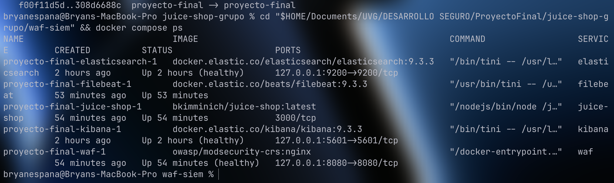
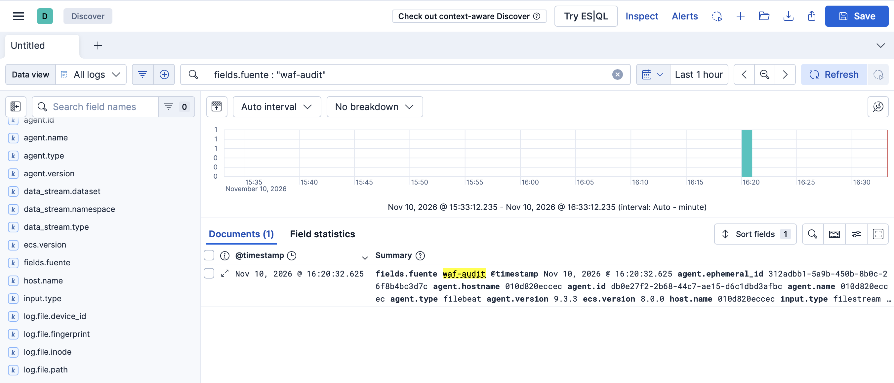
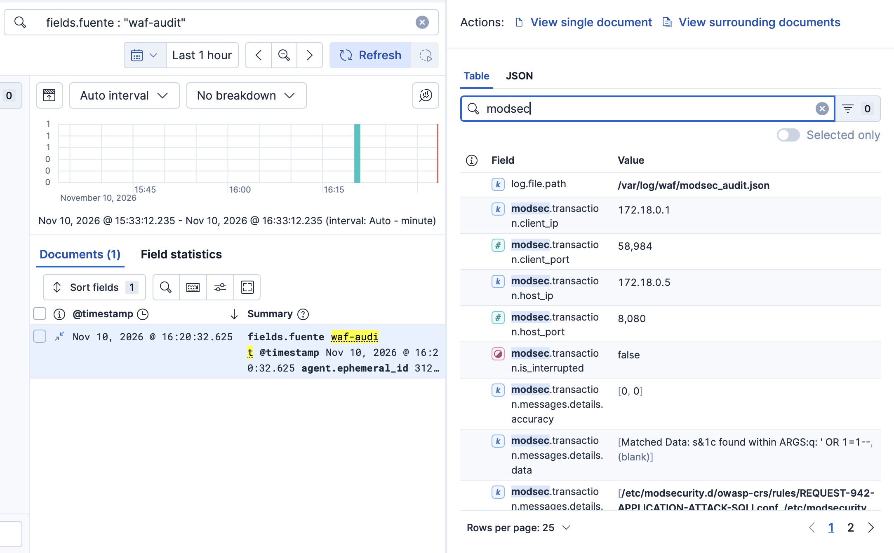
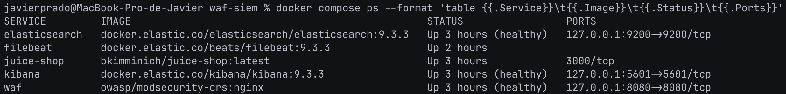
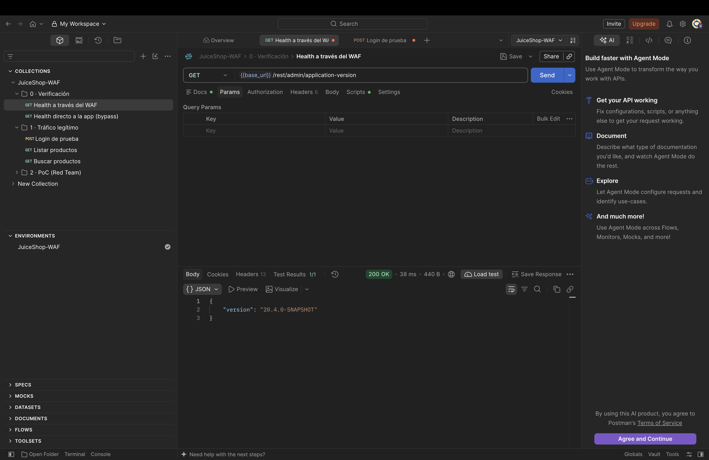
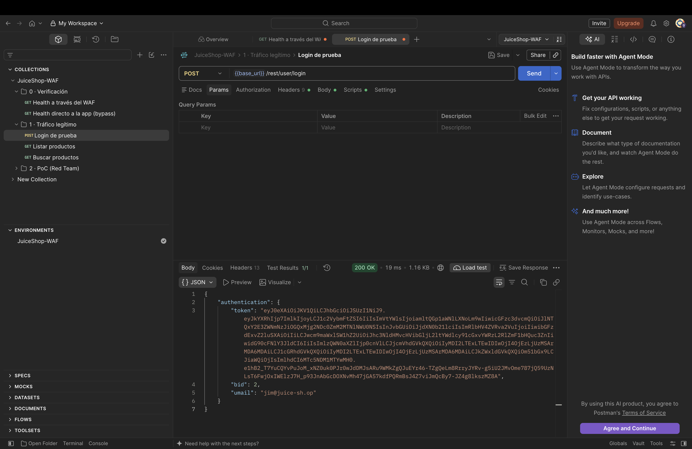
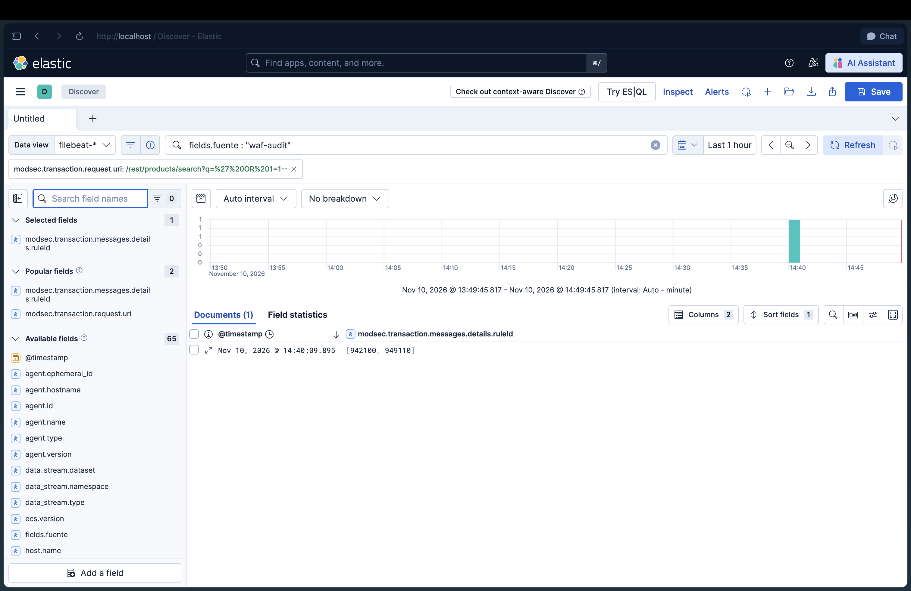
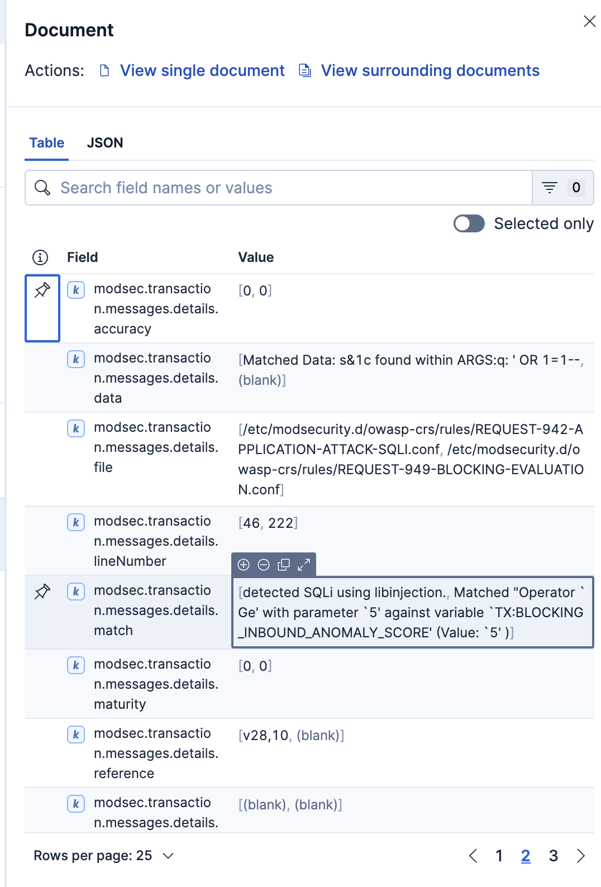

# Hito 0 · Arranque — OWASP Juice Shop

Proyecto Final Integrador · Desarrollo Seguro · UVG · Ciclo 2 2026

## Aplicación objetivo
| Dato | Valor |
| --- | --- |
| Aplicación | OWASP Juice Shop (fork público del grupo) |
| Repositorio | https://github.com/Javilejoo/juice-shop — rama `proyecto-final`, topic `proyecto-final` |
| Ejecución | Servicio `juice-shop` en `waf-siem/docker-compose.yml` (Opción B, sin puerto publicado) |
| A través del WAF | http://localhost:8080 |
| Cuentas | Solo cuentas de prueba de Juice Shop |

## Roles
> El enunciado pide grupos de 4 (2 Red / 2 Blue). Este grupo es de **3 integrantes**. Aprobado por el docente: ☐ sí ☐ pendiente

| Integrante | Rol | Equipo | Responsabilidades |
| --- | --- | --- | --- |
| Javier | Blue Team (líder del repo) | Mac | Repo, entorno, H3: reglas Kibana, dashboard, WAF en On, falsos positivos |
| Bryan | Blue Team | Mac | H1: control por requisito · H2: umbral del gate · H3: reglas y exclusiones |
| Luispe | Red Team | Windows | H1: reconocimiento · H2: ZAP + Burp por `:8080`, ≥3 PoC clasificados · H3/H4: repetir PoC |
| Los 3 | Todo el grupo | — | Pipeline DevSecOps, remediación con IA, informe, presentación |

## Arquitectura
```
Navegador / Postman / ZAP / Burp ──► WAF :8080 (ModSecurity + OWASP CRS) ──► juice-shop:3000 (red interna de Docker)
                                         │ access.log / modsec_audit.json
                                         ▼
                                     Filebeat ──► Elasticsearch :9200 ──► Kibana :5601
```

## Estado del entorno por integrante
| Integrante | Equipo | Juice Shop + WAF | SIEM | Fecha |
| --- | --- | --- | --- | --- |
| Javier | Mac | ☑ | ☑ | 2026-11-10 |
| Bryan | Mac | ☑ | ☑ | 2026-11-10 |
| Luispe | Windows | ☐ | n/a | |

## Evidencias (`docs/hito-0/img/`)
| Evidencia | Bryan | Javier |
| --- | --- | --- |
| Contenedores (`docker compose ps`) | [x] `01-docker-compose-ps.png` | [x] `01-docker-compose-ps-javier.png` |
| Postman: health por el WAF | — | [x] `02-postman-health-waf.png` |
| Postman: login de prueba | — | [x] `03-postman-login.png` |
| Kibana Discover (`waf-audit`) | [x] `04-kibana-discover.png` | [x] `04-kibana-discover-javier.png` |
| Documento de ModSecurity | [x] `05-kibana-documento-modsec.png` | [x] `05-kibana-documento-modsec-javier.png` |

### Evidencia de Bryan (2026-11-10)
- `verificar.sh todo`: Elasticsearch, Kibana, WAF (HTTP 200) y Filebeat en OK; data stream `.ds-filebeat-9.3.3-2026.11.10-000001`.
- Prueba del CRS a las 16:20:32 (hora local): `GET /rest/products/search?q=' OR 1=1--` → el WAF en DetectionOnly la registra con una regla de `REQUEST-942-APPLICATION-ATTACK-SQLI` (`fields.fuente : "waf-audit"`, ver `img/04` y `img/05`) y la deja pasar (HTTP 500 de la app).
- Nota: Filebeat 9 no lee un archivo hasta que pasa de 1024 bytes; con poco tráfico `verificar.sh filebeat` falla aunque todo esté bien. Ajuste propuesto: `prospector.scanner.fingerprint.length: 64` en los inputs de `waf-siem/filebeat.yml`.





### Evidencia de Javier (2026-11-10)

**01 · Contenedores.** Los 5 servicios en ejecución. Juice Shop solo expone `3000/tcp` dentro de la red de Docker; WAF, Kibana y Elasticsearch escuchan únicamente en `127.0.0.1`.



**02 · Health a través del WAF (Postman).** `GET {{base_url}}/rest/admin/application-version` con `base_url = http://localhost:8080` → **200 OK** (`"version": "20.4.0-SNAPSHOT"`).



**03 · Login de prueba (Postman).** `POST {{base_url}}/rest/user/login` con la cuenta de prueba `jim@juice-sh.op` → **200 OK** con token JWT.



**04 · Evento del WAF en Kibana.** Discover, data view `filebeat-*`, filtro `fields.fuente : "waf-audit"`. Petición de prueba `GET /rest/products/search?q=' OR 1=1--` (14:40 hora local) registrada con las reglas **942100** (SQLi detectada con libinjection) y **949110** (umbral de anomalía superado).



**05 · Documento de ModSecurity.** `Matched Data: s&1c found within ARGS:q: ' OR 1=1--`, reglas `REQUEST-942-APPLICATION-ATTACK-SQLI` y `REQUEST-949-BLOCKING-EVALUATION`, anomaly score 5. En `DetectionOnly` el WAF registra pero no bloquea (`is_interrupted = false`), por eso la petición llega a Juice Shop y responde 500.



## Verificación de bypass
| Prueba | Resultado esperado | Resultado obtenido |
| --- | --- | --- |
| `http://localhost:3000` (directo a Juice Shop) | No responde (Opción B) | **Bryan, 2026-11-10:** no responde. `docker compose ps` muestra `3000/tcp` sin puerto publicado al host (ver `img/01-docker-compose-ps.png`). Por `:8080` responde HTTP 200. **Javier, 2026-11-10:** no responde (`connection refused` en curl); por `:8080` responde HTTP 200 (ver `img/01-docker-compose-ps-javier.png`). |

## Modo del WAF
`MODSEC_RULE_ENGINE=DetectionOnly` (H0–H2). Pasa a `On` en el H3.

## Checklist H0
- [x] Roles escritos
- [x] Topic `proyecto-final` en el repositorio
- [x] Workflows originales de Juice Shop desactivados/eliminados
- [x] Juice Shop responde por `:8080`
- [x] Eventos del WAF en Kibana
- [x] Bypass verificado y anotado
