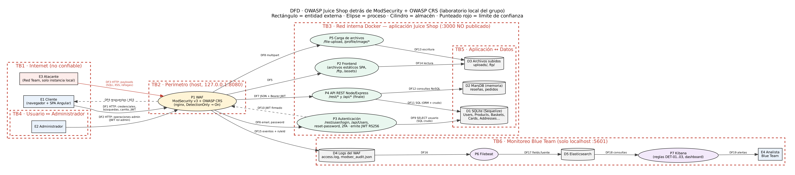

# Hito 1 · Diseño seguro

> Responsable del hito: **Bryan España** (Blue Team). Superficie de ataque: **Luis Pedro Montenegro** (Red Team).
> Requisitos verificados por pipeline: **Javier Prado** (Blue Team).
> Metodología: PASTA (UcedaVélez y Morana, 2015) con STRIDE en la etapa 4.

Integrantes y roles:

| Nombre | Rol |
|---|---|
| Luis Pedro Montenegro | Equipo rojo |
| Bryan España | Equipo azul — dueño del H1, umbral del gate y documento del H2 |
| Javier Prado | Equipo azul — entorno, pipeline DevSecOps |

> El grupo tiene 3 integrantes: 2 en Blue Team (el bloque con más infraestructura: WAF, SIEM, pipeline) y 1 en Red Team.
> Cada PoC queda escrita de forma reproducible para que cualquiera la repita en la demo.

---

## DFD

### Elementos

| Tipo | ID | Elemento | Notas |
|---|---|---|---|
| Entidad | E1 | Cliente (navegador) | Corre la SPA Angular; todo lo que envía es controlable por él |
| Entidad | E2 | Administrador | Mismo canal HTTP que el cliente; se distingue solo por el `role` dentro del JWT |
| Entidad | E3 | Atacante | Red Team; solo contra `localhost:8080` del grupo |
| Entidad | E4 | Analista Blue Team | Kibana en `localhost:5601` |
| Proceso | P1 | WAF (ModSecurity v3 + OWASP CRS, nginx) | Único punto de entrada; inicia en `DetectionOnly`, pasa a `On` en H3 |
| Proceso | P2 | Frontend (estáticos SPA, `/ftp`, `/assets`) | Servido por el mismo Express |
| Proceso | P3 | Autenticación | `/rest/user/login`, `/api/Users`, `/rest/user/reset-password`, `/rest/2fa/*`; emite JWT RS256 |
| Proceso | P4 | API REST Node/Express | Rutas manuales `/rest/*` y API generada por *finale* `/api/<Modelo>s` |
| Proceso | P5 | Carga de archivos | `/file-upload` (quejas: PDF/ZIP/XML/YAML), `/profile/image/file`, `/profile/image/url` |
| Proceso | P6/P7 | Filebeat / Kibana | Ingesta y análisis de los logs del WAF |
| Almacén | D1 | SQLite (Sequelize) | Users, Products, Baskets, BasketItems, Cards, Addresses, Complaints… |
| Almacén | D2 | MarsDB (en memoria) | Reseñas (`posts`) y pedidos (`orders`) |
| Almacén | D3 | Archivos subidos | `uploads/`, `ftp/` |
| Almacén | D4/D5 | Logs del WAF / Elasticsearch | `access.log`, `modsec_audit.json` → índice `filebeat-*` con `fields.fuente: "waf-audit"` |

### Límites de confianza

| ID | Límite | Qué lo cruza | Por qué es límite |
|---|---|---|---|
| TB1→TB2 | **Internet ↔ WAF** | Todo el tráfico HTTP (DF1–DF3) | El navegador y el código Angular están bajo control del usuario |
| TB2→TB3 | **WAF ↔ aplicación** | Peticiones que el CRS dejó pasar (DF5–DF8) | El WAF filtra firmas, no entiende la lógica de negocio: la app debe validar todo otra vez. Juice Shop no publica `:3000`, así que no hay *bypass* del WAF (verificado en H0: `:3000` no abre) |
| TB5 | **Aplicación ↔ base de datos** | SQL crudo y ORM (DF9, DF11), NoSQL (DF12), escritura de archivos (DF13) | Si la app concatena datos del usuario, la base ejecuta lo que mandó el atacante |
| TB4 | **Usuario ↔ administrador** | El mismo endpoint sirve a ambos; el privilegio depende del claim `role` del JWT | Cualquier fallo de autorización o de firma del JWT convierte a un cliente en admin |
| TB6 | WAF ↔ monitoreo | Logs con payloads del atacante (DF15–DF17) | Los logs contienen datos no confiables; Kibana solo escucha en localhost |

---

## STRIDE

Una amenaza por letra, cada una sobre un componente del DFD. La evidencia en código es del fork (`juice-shop` v20.3.0).

| Letra | Amenaza | Componente | Control |
|---|---|---|---|
| **Suplantación** | Suplantar a otro usuario con un JWT robado o **falsificado**: la llave privada RS256 está escrita en el código (`lib/insecurity.ts:21`), así que cualquiera que lea el repo puede firmar tokens válidos | P3 Autenticación (JWT) | Llave fuera del código (secreto/variable de entorno), validar firma, `alg`, expiración y emisor; detección de secretos en SAST |
| **Manipulación** | Modificar la cantidad o el producto de un ítem del carrito (cantidades negativas, `BasketId` ajeno) | P4 API `/api/BasketItems` | Validación del lado servidor de cantidad, producto y dueño del carrito |
| **Repudio** | Un cliente niega una compra o reseña porque la app no registra quién hizo qué (solo hay logs HTTP del WAF) | P4 Pedidos `/rest/basket/:id/checkout` | Logs de auditoría de la app (usuario, IP, hora) + logs del WAF en Elastic |
| **Divulgación de información** | Leer correos y hashes de todos los clientes con SQLi `UNION` en la búsqueda: la consulta concatena `q` (`routes/search.ts:23`) | P4 `/rest/products/search` → D1 | Consultas parametrizadas + WAF reglas 942\* + regla DET-01 en Kibana |
| **Denegación de servicio** | Ráfagas de peticiones al login: `/rest/user/login` no tiene rate limit (solo lo tienen reset-password y 2FA en `server.ts:371,487`) | P3 `/rest/user/login` | Rate limiting en la app + regla de ráfagas por IP en Kibana (DET-03) |
| **Elevación de privilegios** | Entrar como administrador con SQLi en el login (`' OR 1=1--`): la consulta concatena `email` (`routes/login.ts:34`) | P3 `/rest/user/login` → D1 | Consultas parametrizadas + SAST (Semgrep) + WAF 942\* |

El análisis extendido (22 amenazas con probabilidad × impacto, OWASP 2025 y CWE) está en la etapa 4 de PASTA.

---

## PASTA

### Etapa 1 · Objetivos del negocio

Tratamos Juice Shop como una **tienda en línea real** de jugos: clientes se registran, buscan, compran, pagan con tarjeta o billetera, dejan reseñas y quejas; un equipo administra catálogo y usuarios.

| ID | Objetivo de negocio | Por qué importa para la seguridad |
|---|---|---|
| OB-01 | Vender 24/7 | Una caída o DoS es pérdida directa de ventas |
| OB-02 | Proteger datos personales y de pago | Filtración = multas, pérdida de confianza, notificación obligatoria |
| OB-03 | Que cada cliente solo vea y modifique lo suyo | Fraude y acceso a cuentas ajenas |
| OB-04 | Integridad de catálogo, precios y reseñas | Precios manipulados = pérdidas; reseñas maliciosas = daño reputacional |
| OB-05 | Cumplir PCI DSS v4.0 y privacidad (referencia: RGPD) | Sin PCI no se procesan tarjetas |
| OB-06 | Detectar y responder a incidentes | Sin logs ni alertas no se sabe qué pasó |

**Activos e impacto si se comprometen**

| Activo | C | I | D | Impacto |
|---|:-:|:-:|:-:|---|
| Cuentas de clientes (correo, hash de contraseña) | Alta | Alta | Media | Robo de cuentas, fraude, multas |
| Datos de pago (tarjetas, billetera) y direcciones | Alta | Alta | Media | Fraude financiero, incumplimiento PCI DSS |
| Cuenta de administrador | Alta | Alta | Alta | Compromiso total de la tienda |
| Pedidos e historial | Media | Alta | Media | Disputas, fraude |
| Catálogo y precios | Baja | Alta | Alta | Ventas a precio incorrecto |
| Reputación (reseñas, quejas) | Baja | Media | Baja | Contenido malicioso hacia otros clientes |

**Apetito de riesgo.** No aceptable: acceso a datos de otros clientes, toma de cuenta admin, robo de datos de pago, ejecución de código. Aceptable con control compensatorio (WAF + monitoreo) y fecha de corrección: severidad media. Este criterio se traslada al security gate del H2.

### Etapa 2 · Alcance técnico

| Componente | Tecnología | Detalle |
|---|---|---|
| Frontend | Angular / TypeScript | SPA servida por el mismo Express |
| API | Node.js + Express | `/rest/*` (rutas manuales) y `/api/*` (generada por finale sobre Sequelize) |
| Base de datos | SQLite con Sequelize; MarsDB en memoria | SQL crudo en login y búsqueda |
| Autenticación | JWT RS256, `expiresIn: 6h` | Contraseñas con MD5 sin sal (`lib/insecurity.ts:41`) |
| Archivos | `/file-upload`, `/profile/image/*`, `/ftp` | ZIP, XML, YAML, PDF |
| WAF | ModSecurity v3 + OWASP CRS (`owasp/modsecurity-crs:nginx`) | Paranoia 1, `DetectionOnly` → `On` |
| SIEM | Filebeat → Elasticsearch 9.3.3 → Kibana | Solo localhost |
| Contenedores | Docker Compose (`waf-siem/`) | Juice Shop sin `ports:`, solo detrás del WAF |
| CI/CD | GitHub Actions `devsecops.yml` | Semgrep, npm audit, Syft (CycloneDX), ZAP baseline |

**Fuera de alcance:** `juice-shop.herokuapp.com` y cualquier sistema de la UVG o de terceros; infraestructura de GitHub, Docker Hub y Elastic; ingeniería social, ataques físicos, DoS volumétrico.

**Supuestos:** configuración por defecto de Juice Shop; laboratorio sin TLS (en producción sería obligatorio, ver RS-06); Elasticsearch sin autenticación porque solo escucha en 127.0.0.1 (riesgo aceptado del laboratorio).

### Etapa 3 · Descomposición de la aplicación

Componentes y flujos según el DFD de arriba. Puntos de entrada tomados de `server.ts` del fork y **confirmados por el reconocimiento del Red Team** (ver *Superficie de ataque*):

| ID | Punto de entrada | Proceso | ¿Sesión? | Datos que recibe | Flujo |
|---|---|---|:-:|---|---|
| EP-01 | `POST /rest/user/login` | P3 | No | email, password | DF6 → DF9 |
| EP-02 | `POST /api/Users` | P3 | No | email, password, passwordRepeat, securityQuestion, **role** | DF6 → DF9 |
| EP-03 | `GET /rest/products/search?q=` | P4 | No | q | DF7 → DF11 |
| EP-04 | `GET /rest/basket/:id`, `POST/PUT /api/BasketItems` | P4 | Sí | id, ProductId, BasketId, quantity | DF7 → DF11 |
| EP-05 | `GET/PUT /rest/products/:id/reviews`, `PATCH /rest/products/reviews` | P4 | Parcial | message, author, id | DF7 → DF12 |
| EP-06 | `POST /api/Feedbacks` | P4 | No | comment, rating, captcha | DF7 → DF11 |
| EP-07 | `POST /file-upload`, `/profile/image/*` | P5 | Parcial | archivo, url | DF8 → DF13 |
| EP-08 | `GET /ftp/*`, `/encryptionkeys/*`, `/support/logs/*` | P2 | No | nombre de archivo | DF5 → DF14 |
| EP-09 | `POST /rest/user/reset-password`, `GET /rest/user/security-question` | P3 | No | email, answer, new | DF6 → DF9 |
| EP-10 | `/api/Cards`, `/api/Addresss`, `/rest/wallet/balance` | P4 | Sí | datos de pago y dirección | DF7 → DF11 |
| EP-11 | `POST /rest/basket/:id/checkout`, `GET /rest/track-order/:id` | P4 | Parcial | id de carrito/pedido | DF7 → DF12 |
| EP-12 | `GET /rest/admin/application-configuration`, `/api-docs` | P4 | No | — | DF7 |
| EP-13 | Encabezado `Authorization: Bearer <JWT>` | P3/P4 | — | token en todas las peticiones autenticadas | DF1, DF2 |

### Etapa 4 · Análisis de amenazas

**Agentes de amenaza**

| ID | Agente | Motivación | Capacidad |
|---|---|---|---|
| TA-01 | Atacante oportunista | Robo de datos, defacement | Baja-media (escáneres, payloads públicos) |
| TA-02 | Cliente malicioso registrado | Fraude, ver datos ajenos, manipular precios | Media (proxy tipo Burp) |
| TA-03 | Atacante dirigido | Cuenta admin y datos de pago | Alta (encadena vulnerabilidades) |
| TA-04 | Cadena de suministro (npm) | Código dentro del servidor | Alta |

**Escala:** Probabilidad (1–3) × Impacto (1–3). 7–9 Alto · 3–6 Medio · 1–2 Bajo. Juice Shop es pública y conocida, así que los ataques documentados tienen probabilidad alta.

| ID | Componente | STRIDE | Amenaza | Entrada | P | I | Riesgo | OWASP 2025 / CWE | Requisito |
|---|---|:-:|---|---|:-:|:-:|:-:|---|---|
| T-01 | P3 Autenticación | S/E | SQLi en el login para entrar como cualquier usuario, incluido admin | EP-01 | 3 | 3 | **Alto 9** | A05 / CWE-89 | RS-01 |
| T-02 | P3 Autenticación | S | Fuerza bruta / credential stuffing sin límite de intentos | EP-01 | 3 | 3 | **Alto 9** | A07 / CWE-307 | RS-04 |
| T-03 | P3 Autenticación | S | Falsificar JWT con la llave privada expuesta en el código | EP-13 | 2 | 3 | Medio 6 | A04 / CWE-321 | RS-05 |
| T-04 | P3 Autenticación | S | Restablecer contraseña ajena adivinando la pregunta de seguridad | EP-09 | 2 | 3 | Medio 6 | A07 / CWE-640 | RS-04 |
| T-05 | P4 API | I/T | SQLi UNION en la búsqueda para leer o alterar tablas | EP-03 | 3 | 3 | **Alto 9** | A05 / CWE-89 | RS-01 |
| T-06 | P4 API | T | Cantidades negativas o `BasketId` ajeno en el carrito | EP-04 | 3 | 2 | Medio 6 | A06 / CWE-20 | RS-02 |
| T-07 | P4 API | T | Inyección NoSQL en reseñas para modificar documentos ajenos | EP-05 | 2 | 2 | Medio 4 | A05 / CWE-943 | RS-01 |
| T-08 | P4 / navegador | T | XSS en búsqueda, reseñas o feedback | EP-03, EP-05, EP-06 | 3 | 2 | Medio 6 | A05 / CWE-79 | RS-03 |
| T-09 | P4 Pedidos | R | Negar una compra por falta de logs de auditoría de la app | EP-11 | 2 | 2 | Medio 4 | A09 / CWE-778 | RS-09 |
| T-10 | P1 WAF / SIEM | R | Ataques sin registro o alertas que nadie revisa | Todas | 2 | 3 | Medio 6 | A09 / CWE-778 | RS-09, RS-10 |
| T-11 | P4 API | I | IDOR: ver el carrito o pedidos de otro cambiando el id | EP-04, EP-10 | 3 | 3 | **Alto 9** | A01 / CWE-639 | RS-02 |
| T-12 | P2 Frontend | I | Descargar respaldos confidenciales de `/ftp` evadiendo el filtro de extensión | EP-08 | 3 | 2 | Medio 6 | A01 / CWE-22 | RS-07 |
| T-13 | P4 API | I | Errores con stack trace o SQL que revelan la estructura | Todas | 3 | 1 | Medio 3 | A10 / CWE-209 | RS-08 |
| T-14 | DF1 tráfico | I | Credenciales y JWT sin TLS | DF1, DF2 | 2 | 3 | Medio 6 | A04 / CWE-319 | RS-06 |
| T-15 | D1 SQLite | I | Contraseñas con MD5 sin sal, crackeables si se filtra la base | D1 | 2 | 3 | Medio 6 | A04 / CWE-916 | RS-06 |
| T-16 | P5 Carga | D | Archivos grandes o ZIP bomb para agotar recursos | EP-07 | 2 | 2 | Medio 4 | A06 / CWE-400 | RS-07 |
| T-17 | P3 / P4 | D | Ráfagas o escaneo automatizado que degradan la tienda | Todas | 3 | 2 | Medio 6 | A06 / CWE-770 | RS-04, RS-10 |
| T-18 | P5 Carga | E | XXE en la carga de XML para leer archivos del servidor | EP-07 | 2 | 3 | Medio 6 | A02 / CWE-611 | RS-07 |
| T-19 | P3 Registro | E | Registrarse enviando `"role":"admin"` (asignación masiva) | EP-02 | 2 | 3 | Medio 6 | A01 / CWE-915 | RS-02 |
| T-20 | P4 API | E | Acceder a funciones de administración sin ser admin | EP-12, EP-13 | 3 | 3 | **Alto 9** | A01 / CWE-862 | RS-02 |
| T-21 | Dependencias npm | E | Dependencia vulnerable o comprometida ejecuta código | Build | 2 | 3 | Medio 6 | A03 / CWE-1395 | RS-11 |
| T-22 | P1 WAF | T | Evadir el WAF con codificación u ofuscación | DF3 | 2 | 3 | Medio 6 | A05 / CWE-693 | RS-10 |

**Escenarios priorizados (insumo de las PoC del H2):** T-01 y T-05 (SQLi) → regla DET-01; T-08 (XSS) → DET-02; T-11 (IDOR) → el WAF no lo ve, se corrige en código; T-02/T-17 (ráfagas) → DET-03; T-20 (admin) → candidato a corrección con IA en H4.

### Etapa 5 · Vulnerabilidades

Juice Shop es vulnerable a propósito; aquí van las vulnerabilidades **confirmadas** que sostienen las amenazas de la etapa 4. Fuentes: (a) revisión del código del fork, (b) reconocimiento del Red Team, (c) reportes del pipeline (Semgrep, npm audit, ZAP) del H2.

| Hallazgo | Dónde está | Relación con el DFD | Fuente | Amenaza |
|---|---|---|---|---|
| SQL concatenado en el login | `routes/login.ts:34` | DF9, TB5 | Código / Semgrep | T-01 |
| SQL concatenado en la búsqueda | `routes/search.ts:23` | DF11, TB5 | Código / Semgrep | T-05 |
| Llave privada RS256 escrita en el código | `lib/insecurity.ts:21` | P3, TB4 | Código / Semgrep `hardcoded-jwt-secret` en `:54`, donde se firma con esa llave (WARNING) | T-03 |
| Hash de contraseñas MD5 sin sal | `lib/insecurity.ts:41` | D1 | Código (Semgrep **no** lo detecta) | T-15 |
| Login sin rate limit | `server.ts:624` (solo `:371`, `:487` tienen límite) | P3, TB1→TB2 | Código | T-02, T-17 |
| Listado de directorios en `/ftp`, `/encryptionkeys`, `/support/logs` | `server.ts:290-304` | P2 → D3 | Código / Semgrep `express-check-directory-listing` (`server.ts:273, 294, 298, 302, 306`, WARNING). ZAP baseline no lo reportó | T-12 |
| *(completar con el reconocimiento de Luis Pedro)* | | | Red Team | |
| Dependencias JWT vulnerables: `jsonwebtoken` ≤8.5.1 (*Verification Bypass*, **critical**), `express-jwt` ≤7.7.7 (*Authorization bypass*, high), `jws` ≤3.2.2 (*Forgeable tokens*, high) | `package.json` | P3, TB4 | Pipeline SCA (npm audit) | T-03, T-21 |
| `marsdb` (*Command Injection*, **critical**, sin versión corregida) | `package.json` | D2, DF12 | Pipeline SCA (npm audit) | T-07, T-21 |
| `sanitize-html` ≤2.17.7 (*Improper Input Validation*, high) | `package.json` | P4 (reseñas, quejas) | Pipeline SCA (npm audit) | T-08, T-21 |
| `crypto-js` ≤4.1.1 vía `pdfkit` (*PBKDF2 débil*, **critical**), `lodash` (*Prototype Pollution*, critical), `tar` (*path traversal*, critical), `moment` (ReDoS, high) | `package.json` | Dependencias | Pipeline SCA (npm audit) | T-21 |
| **Total npm audit (`--omit=dev`):** 6 critical, 12 high, 7 moderate, 2 low | corrida [42892293620](https://github.com/Javilejoo/juice-shop/actions/runs/42892293620) | Dependencias | Pipeline SCA | T-21 |
| Falta la cabecera **Content-Security-Policy** (ZAP 10038, Medium) en 5 URLs | Respuestas de la app | DF4 | Pipeline DAST (ZAP baseline) | T-08 |
| **Cross-Domain Misconfiguration**: CORS permisivo (ZAP 10098, Medium) | Respuestas de la app | DF4 | Pipeline DAST (ZAP baseline) | T-13 |
| Faltan `Cross-Origin-Embedder-Policy` / `Cross-Origin-Opener-Policy`; `Feature-Policy` obsoleta; funciones JS peligrosas (ZAP, Low) | Respuestas de la app | DF4 | Pipeline DAST (ZAP baseline) | T-13, T-14 |
| **Total ZAP baseline:** 0 alto, 2 medio, 4 bajo, 3 informativos. No reportó divulgación de errores ni HSTS (escaneo pasivo sobre HTTP) | corrida [42892293620](https://github.com/Javilejoo/juice-shop/actions/runs/42892293620) | DF4 | Pipeline DAST | T-13, T-14 |

---

## Superficie de ataque

*Sección del Equipo rojo (Luis Pedro). Mapa en `superficie.png`.*

- **Rutas y métodos:** ver EP-01..EP-13 en la etapa 3; Luis Pedro confirma cuáles respondieron por `:8080` y agrega las que encuentre en el JS del frontend.
- **Roles:** anónimo, `customer`, `deluxe`, `accounting`, `admin` (claim `role` del JWT).
- **Límites:** navegador → WAF (`:8080`) → API (`:3000`, no publicado) → SQLite/MarsDB.
- **Bypass del WAF:** `http://localhost:3000` **no responde** (Juice Shop sin `ports:`). *(Confirmar con captura.)*
- **Candidatas a PoC del H2:** CA-01 SQLi login, CA-02 SQLi búsqueda, CA-03 XSS, CA-04 IDOR carrito, CA-05 ráfagas.

---

## Requisitos de seguridad

Cada requisito sale de una amenaza y dice **qué control lo comprueba** (pipeline, regla de Kibana o WAF) y en qué hito se ve.

| ID | Requisito | Amenaza que cubre | Control que lo comprueba | Cómo se comprueba después |
|---|---|---|---|---|
| RS-01 | Toda consulta SQL/NoSQL usa parámetros o el ORM; ningún dato del usuario se concatena | T-01, T-05, T-07 | **Pipeline** SAST Semgrep (`express-sequelize-injection`, severidad ERROR → dispara el gate) + **Pipeline** SCA (`marsdb` critical) + **WAF** CRS 942\* + **Kibana** DET-01 | H2: ✅ Semgrep marca `login.ts:34` y `search.ts:23` como ERROR. H3: DET-01 muestra los PoC. H4: Semgrep limpio y PoC falla |
| RS-02 | Cada endpoint verifica en el servidor dueño del recurso y rol (deny-by-default); el `role` nunca se acepta del cliente | T-06, T-11, T-19, T-20 | **Revisión manual** (ni el WAF ni el pipeline actual lo ven: lógica de negocio). En el H4 se agrega una prueba de regresión al pipeline | H2: PoC IDOR/admin. H4: test de regresión falla antes y pasa después |
| RS-03 | Salida codificada por contexto y Content-Security-Policy restrictiva | T-08 | **WAF** CRS 941\* + **Kibana** DET-02 + **Pipeline** DAST ZAP (cabecera CSP) + **Pipeline** SCA (`sanitize-html`) | H2: ✅ ZAP reporta falta de CSP (10038, Medium); npm audit marca `sanitize-html` (high). H3: DET-02 con hora y payload |
| RS-04 | Login y reset limitan intentos (5 fallidos por cuenta/IP en 15 min); reset no depende solo de la pregunta secreta | T-02, T-04, T-17 | **Kibana** DET-03 (ráfagas por IP) | H3: la ráfaga del Red Team aparece en DET-03 con su IP y hora |
| RS-05 | JWT firmado con llave fuera del código; se valida firma, `alg`, expiración y emisor | T-03 | **Pipeline** SAST Semgrep `hardcoded-jwt-secret` (WARNING: se reporta pero no dispara el gate, que corta en ERROR) + **Pipeline** SCA (`jsonwebtoken` critical, `express-jwt` y `jws` high) | H2: ✅ Semgrep marca `insecurity.ts:54` (firma con la llave definida en `:21`); npm audit marca `jsonwebtoken` ≤8.5.1 (*Verification Bypass*). H4: llave en variable de entorno y librerías actualizadas |
| RS-06 | Contraseñas con bcrypt/Argon2 con sal; TLS 1.2+ en producción | T-14, T-15 | **Revisión de código** (Semgrep **no** detecta el MD5 de `insecurity.ts:41`) + **Pipeline** SCA (`crypto-js` critical, PBKDF2 débil). TLS/HSTS queda fuera del pipeline: el laboratorio corre por HTTP y ZAP solo revisa HSTS sobre HTTPS | H2: brecha documentada (el pipeline no cubre MD5 ni TLS). H4: hash con bcrypt verificado en revisión |
| RS-07 | Carga y descarga con lista blanca de tipos, tamaño máximo, sin entidades XML externas; `/ftp` sin archivos confidenciales | T-12, T-16, T-18 | **WAF** CRS 930\* (path traversal) + **Pipeline** SAST Semgrep `express-check-directory-listing` (WARNING) + **Pipeline** SCA (`tar` critical, path traversal) | H2: ✅ Semgrep marca los listados de directorio en `server.ts` (`/ftp`, `/encryptionkeys`, `/support/logs`); ZAP baseline no los reportó. H3: PoC de `/ftp` aparece en logs del WAF |
| RS-08 | Errores genéricos al usuario; detalle solo en logs | T-13 | **PoC del Red Team** + revisión de código. ZAP baseline **no** lo cubre: es pasivo y no envía payloads que provoquen errores | H2: el PoC de SQLi muestra el HTTP 500 con detalle del error. H4: respuesta genérica verificada |
| RS-09 | Eventos de seguridad registrados (login, pedidos, errores de autorización) con usuario, IP y hora, sin contraseñas ni tarjetas | T-09, T-10 | **Kibana** (logs del WAF y de la app en Elastic) | H3: eventos visibles en el dashboard "WAF - Blue Team" |
| RS-10 | El WAF inspecciona todo el tráfico y el SIEM tiene reglas SQLi, XSS y ráfagas, revisadas | T-10, T-17, T-22 | **WAF** en `On` + **Kibana** DET-01..03 | H3: las 3 reglas detectan los PoC reales; en `On` responden 403 |
| RS-11 | Cada build genera SBOM y analiza dependencias; high/critical se reportan y luego bloquean | T-21 | **Pipeline** SCA (`npm audit --audit-level=high`) + **Pipeline** SBOM Syft CycloneDX | H2: ✅ `sbom.cdx.json` (CycloneDX 1.6, 539 componentes, 533 npm) como artefacto; npm audit: 6 critical, 12 high |

> **Verificación de los controles del pipeline** (Javier, 2026-11-10): cada fila marcada con ✅ se comprobó contra los reportes de la corrida [42892293620](https://github.com/Javilejoo/juice-shop/actions/runs/42892293620) (`semgrep.sarif`, `npm-audit.json`, `sbom.cdx.json`, `reporte-zap.json`). Brechas encontradas: Semgrep no detecta el MD5 (RS-06); ZAP baseline no cubre divulgación de errores (RS-08) ni HSTS (RS-06); la llave JWT (RS-05) y los listados de directorio (RS-07) salen como WARNING, así que se reportan pero no disparan el gate.

---

## Casos de abuso

El *Entonces* es el **comportamiento seguro esperado**. Hoy Juice Shop no lo cumple (es vulnerable a propósito): el Red Team lo demuestra en H2, el Blue Team lo detecta y bloquea en H3, y la corrección del H4 hace que el caso pase. Todos se ejecutan **solo** contra `http://localhost:8080`.

### CA-01 · Inyección SQL en el login
- **Dado** un atacante sin cuenta,
- **Cuando** envía `' OR 1=1--` en el campo `email` de `POST /rest/user/login`,
- **Entonces** el sistema rechaza el acceso con "credenciales inválidas" sin emitir JWT, y el WAF registra una regla 942\* (en `On` responde 403).
- Amenaza T-01 · Requisitos RS-01, RS-10 · Se prueba en H2 (PoC), H3 (DET-01), H4 (corrección)

### CA-02 · Inyección SQL en la búsqueda
- **Dado** un visitante anónimo,
- **Cuando** envía en `GET /rest/products/search?q=` un payload `UNION SELECT` que intenta leer `email` y `password` de la tabla `Users`,
- **Entonces** el sistema trata `q` solo como texto, devuelve únicamente productos, no muestra errores SQL, y el WAF registra 942\*.
- Amenaza T-05 · Requisitos RS-01, RS-08 · H2, H3, H4

### CA-03 · XSS en la búsqueda o reseñas
- **Dado** un usuario que escribe texto que la tienda luego muestra,
- **Cuando** incluye `<iframe src="javascript:alert('xss')">` en la búsqueda o en una reseña,
- **Entonces** la tienda muestra el texto codificado sin ejecutarlo y el WAF registra una regla 941\* visible en DET-02.
- Amenaza T-08 · Requisitos RS-03, RS-10 · H2, H3

### CA-04 · Carrito de otro cliente (IDOR)
- **Dado** un cliente autenticado con su carrito,
- **Cuando** cambia el id en `GET /rest/basket/:id` por el de otro cliente,
- **Entonces** el servidor responde 403 y no devuelve el carrito ajeno. *El WAF no lo detecta porque la petición es válida: la corrección va en el código.*
- Amenaza T-11 · Requisito RS-02 · H2, H4

### CA-05 · Ráfaga contra el login
- **Dado** un atacante con una lista de contraseñas y un correo existente,
- **Cuando** envía más de 20 intentos de login en menos de un minuto desde la misma IP,
- **Entonces** la app bloquea temporalmente después del límite y Kibana genera la alerta DET-03 con la IP y la hora.
- Amenazas T-02, T-17 · Requisitos RS-04, RS-10 · H2, H3

### CA-06 · Registro como administrador
- **Dado** un visitante sin cuenta,
- **Cuando** se registra con `POST /api/Users` incluyendo `"role":"admin"` en el JSON,
- **Entonces** el servidor ignora el rol enviado, crea la cuenta como `customer` y no permite entrar a `/#/administration`.
- Amenazas T-19, T-20 · Requisito RS-02 · H2, H4

### CA-07 · Archivos confidenciales en /ftp
- **Dado** un visitante anónimo,
- **Cuando** pide `/ftp/package.json.bak%2500.md` para evadir el filtro de extensión,
- **Entonces** el servidor responde 403/404 y el WAF registra la regla 920\*/930\* correspondiente.
- Amenaza T-12 · Requisito RS-07 · H2, H3

### Trazabilidad inicial (base de la matriz del informe)

| Caso | Amenaza | OWASP 2025 | CWE | Riesgo | ¿Lo debería ver el WAF/SIEM? |
|---|---|---|---|---|---|
| CA-01 | T-01 | A05 Injection | CWE-89 | Alto | Sí, 942\* / DET-01 |
| CA-02 | T-05 | A05 Injection | CWE-89 | Alto | Sí, 942\* / DET-01 |
| CA-03 | T-08 | A05 Injection | CWE-79 | Medio | Sí, 941\* / DET-02 |
| CA-04 | T-11 | A01 Broken Access Control | CWE-639 | Alto | No (lógica de negocio) |
| CA-05 | T-02 | A07 Authentication Failures | CWE-307 | Alto | Sí, DET-03 (ráfagas) |
| CA-06 | T-19/T-20 | A01 Broken Access Control | CWE-915 / CWE-862 | Alto | Parcial |
| CA-07 | T-12 | A01 Broken Access Control | CWE-22 | Medio | Parcial (920\*/930\*) |

---

*Uso de IA:* se usó Claude (Anthropic) para consolidar la documentación y generar el DFD a partir del análisis del equipo y de la revisión del código del fork. Todo fue revisado por el grupo.
