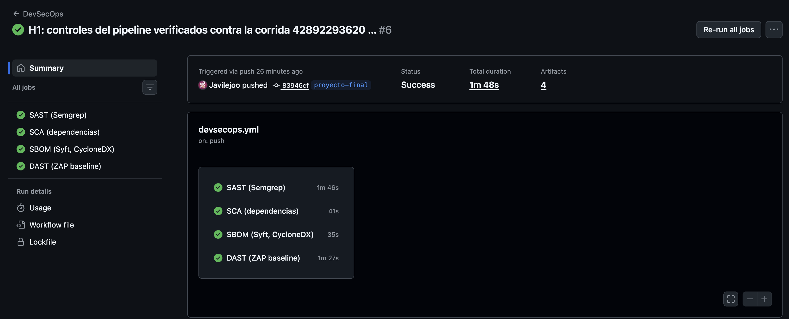
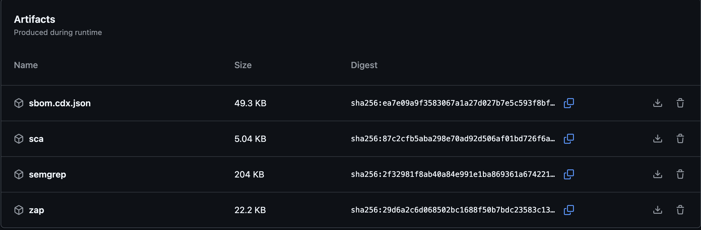

# Hito 2 · Pipeline y ataque

> Pipeline: **Javier Prado** · Umbral del gate y este documento: **Bryan España** · PoC: **Luis Pedro Montenegro**.

## Pipeline

- Workflow: [`.github/workflows/devsecops.yml`](../../.github/workflows/devsecops.yml) — corre en cada `push` y `pull_request`.
- Workflows originales de Juice Shop: eliminados del fork (`git rm .github/workflows`); solo queda `devsecops.yml`.
- Corrida de evidencia: **[DevSecOps #42925768752](https://github.com/Javilejoo/juice-shop/actions/runs/42925768752)** (commit `83946cfb0`, 2026-11-10), los 4 jobs en verde. Mismos resultados que la corrida [42892293620](https://github.com/Javilejoo/juice-shop/actions/runs/42892293620), usada para verificar el H1.
- Modo del gate: **`reporte`** (`SECURITY_GATE: "reporte"`)
- App escaneada por el DAST: la misma imagen de Juice Shop del entorno del grupo, fijada por digest (`bkimminich/juice-shop@sha256:877fc77…`, versión 20.4.0-SNAPSHOT, igual al código del fork).

### Artefactos de la corrida

| Artefacto (nombre en Actions) | Archivo | Control | Resultado |
|---|---|---|---|
| `semgrep` | `semgrep.sarif` | SAST | 66 hallazgos: **12 ERROR**, 51 WARNING, 3 notas |
| `sca` | `npm-audit.json` | SCA | 27 vulnerabilidades: **6 critical, 12 high**, 7 moderate, 2 low |
| `sbom.cdx.json` | `sbom.cdx.json` | SBOM | CycloneDX 1.6, **539 componentes** (533 paquetes npm) |
| `zap` | `reporte-zap.html`, `reporte-zap.json` | DAST | 9 alertas: **0 alto**, 2 medio, 4 bajo, 3 informativo |

**Ajustes al pipeline durante el H2** (ver *Uso de IA*):
- **SCA:** Juice Shop no versiona `package-lock.json` (`.npmrc: package-lock=false`) y `npm audit` lo necesita. El job lo genera con `npm install --package-lock-only --ignore-scripts` (sin instalar ni ejecutar scripts).
- **SBOM:** la primera corrida produjo un SBOM con solo 5 componentes (las GitHub Actions del workflow), porque Syft tampoco encontraba lockfile. Se agregó el mismo paso antes de Syft → 539 componentes.
- **DAST:** levanta la imagen oficial de Juice Shop (compilar el fork tarda >10 min) fijada por digest, para escanear exactamente la app que ataca el Red Team.

### Umbral del security gate y su justificación

| Control | Herramienta | Umbral (falla el gate si…) | Qué hicimos con los hallazgos |
|---|---|---|---|
| SAST | Semgrep (`p/default` + `p/owasp-top-ten`) | Hay al menos un hallazgo de severidad **ERROR** | **Supera el umbral (12 ERROR).** Semgrep marca como ERROR la inyección SQL de `routes/login.ts:34` y `routes/search.ts:23` (`express-sequelize-injection`) → RS-01, PoC-01/02; también `routes/userProfile.ts:65` (`code-string-concat`) y `routes/currentUser.ts:31` (`remote-property-injection`). Los 4 de `data/static/codefixes/` son fragmentos de los retos de código (vulnerables a propósito, no se ejecutan); los 3 `detected-jwt-token` están en pruebas del frontend (`*.spec.ts`) y el de `data/static/users.yml` son datos de prueba: se registran como falsos positivos para el contexto de producción. La llave JWT (`insecurity.ts:54`) y los listados de directorio (`server.ts`) salen como WARNING: se registran, no disparan el gate. El MD5 de `insecurity.ts:41` **no** lo detecta Semgrep (brecha cubierta por revisión de código, RS-06) |
| SCA | `npm audit --omit=dev --audit-level=high` | Hay al menos una vulnerabilidad **high** o **critical** en dependencias de producción | **Supera el umbral: 6 critical, 12 high** (más 7 moderate, 2 low). Critical: `jsonwebtoken` (*verification bypass*), `marsdb` (*command injection*, sin versión corregida), `crypto-js` vía `pdfkit`, `lodash`, `tar`. High: `express-jwt`, `jws`, `sanitize-html`, `moment`, `sqlite3`, `basic-ftp`… Se mapean a RS-05, RS-01, RS-03, RS-06, RS-07 y RS-11; candidatos a actualizar en H4, empezando por las librerías JWT (RS-05) |
| SBOM | Syft, CycloneDX | No es un control de bloqueo: el artefacto `sbom.cdx.json` **siempre** se publica | `sbom.cdx.json` CycloneDX 1.6 con 539 componentes (533 npm). Inventario oficial de versiones; base para SCA y para responder a un nuevo CVE |
| DAST | ZAP baseline (`zap-baseline.py -I`) | Alguna alerta de **riesgo alto** (FAIL) | **No supera el umbral: 0 altas**, 2 medias (falta de CSP 10038 → RS-03; CORS permisivo 10098), 4 bajas (COEP/COOP, `Feature-Policy` obsoleta, funciones JS peligrosas), 3 informativas. ZAP baseline es pasivo y corre por HTTP: no prueba inyecciones, errores (RS-08) ni HSTS (RS-06); eso lo cubren los PoC del Red Team (ZAP activo + Burp) y la revisión de código |

En la corrida, los pasos *gate* de SAST y SCA terminan con código 1 (superan el umbral) y el de DAST no. Como `SECURITY_GATE: "reporte"`, esos pasos usan `continue-on-error` y el pipeline queda en verde.

**Por qué este umbral**

1. **Sale del apetito de riesgo del H1 (PASTA etapa 1).** Definimos como no aceptable el acceso a datos de otros clientes, la toma de cuenta admin y la ejecución de código: eso corresponde a severidad Critical/High. Media se acepta con control compensatorio (WAF + SIEM) y fecha de corrección. Por eso el gate corta en **ERROR** (Semgrep), **high/critical** (npm audit) y **riesgo alto** (ZAP), y deja Medium/Low como registro.
2. **Coincide con la política de gates del curso:** Critical bloquea sin excepción, High bloquea salvo excepción aprobada con expiración, Medium genera seguimiento, Low/Info solo se registra.
3. **Evita ruido:** con `WARNING`/`moderate` como umbral, el gate sumaría 51 WARNING de Semgrep y 7 moderate de npm audit, muchos sin impacto real en producción, y el equipo dejaría de leerlo. `--omit=dev` limita SCA a lo que llega a producción.
4. **Resultado de las corridas 42892293620 y 42925768752:** SAST y SCA superan el umbral y DAST no. En modo `bloqueo` el pipeline habría fallado, lo cual confirma que el umbral detecta lo que el H1 clasificó como no aceptable (SQLi, dependencias JWT críticas).
5. **Modo `reporte` y no `bloqueo`.** Juice Shop es **vulnerable a propósito**: en modo bloqueo el pipeline fallaría en cada push desde el primer día y no tendríamos un pipeline "verde" donde comparar. Siguiendo la adopción incremental vista en clase (reporte → umbrales → primer gate), el pipeline corre los 4 controles, publica todo y marca qué superó el umbral, pero no detiene la integración. En el **H4** cambiamos a `SECURITY_GATE: "bloqueo"` sobre las vulnerabilidades corregidas para demostrar que el gate pasa después de la corrección.
6. **Excepciones:** un hallazgo High que no se corrija en el proyecto queda documentado como riesgo residual (PASTA etapa 7, informe final) con su control compensatorio (regla del WAF o del SIEM).

## PoC del Equipo rojo

WAF en `DetectionOnly`, proxy apuntando a `http://localhost:8080`. ZAP → Burp Repeater → clasificación → repetición en Postman con hora. Fichas completas en [`poc/`](poc/).

- Reporte de ZAP: `poc/<archivo-reporte-zap>.html`

| # | Vulnerabilidad | Endpoint | OWASP Top 10:2025 | CWE | CVSS v3.1 (vector) | Evidencia |
|---|---|---|---|---|---|---|
| PoC-01 | *(Luis Pedro)* | | | | | `poc/01-...` |
| PoC-02 | | | | | | `poc/02-...` |
| PoC-03 | | | | | | `poc/03-...` |
| PoC-04 | | | | | | `poc/04-...` |

> Relación con el H1: cada PoC debe corresponder a un caso de abuso (CA-01..CA-07) y a una amenaza (T-xx).
> Sugeridas: PoC-01 ↔ CA-01 (SQLi login), PoC-02 ↔ CA-02 (SQLi búsqueda), PoC-03 ↔ CA-03 (XSS), PoC-04 ↔ CA-04 (IDOR).

### Relación PoC ↔ pipeline (inicio de la matriz de trazabilidad)

| PoC | Caso de abuso | ¿Lo detectó el pipeline? | Control |
|---|---|---|---|
| PoC-01 | CA-01 | *(Sí/No)* | *(regla Semgrep)* |
| PoC-02 | CA-02 | | |
| PoC-03 | CA-03 | | |
| PoC-04 | CA-04 | *(se espera No: lógica de negocio)* | |

## Registro de ataques

Una fila por intento. Solo cuentas de prueba y solo `localhost:8080`.

| Fecha | Hora | Quién | Herramienta | Método y ruta | Payload | Respuesta |
|---|---|---|---|---|---|---|
| | | | | | | |

---

## Uso de IA

Según la guía de la UVG, se declara cada uso de un asistente de IA, qué se le pidió, qué produjo y cómo lo revisó el grupo.

| Qué | Herramienta | Qué se le pidió | Qué cambió | Revisión del grupo |
|---|---|---|---|---|
| Adaptar la plantilla `devsecops.yml` a Juice Shop (secciones `>>> AJUSTAR <<<`) | **Claude Code** (Anthropic) | Ajustar SCA y DAST al stack de Juice Shop | SCA: generar `package-lock.json` antes de `npm audit` (Juice Shop no lo versiona). DAST: levantar la imagen oficial de Juice Shop en lugar de compilar el fork | Javier revisó el diff antes del commit `4b3e59ec2` |
| Diagnóstico y corrección del pipeline durante el H2 | **Claude Code** (Anthropic) | Revisar la primera corrida y los artefactos | Detectó que el SBOM tenía solo 5 componentes y agregó la generación del lockfile antes de Syft (commit `f00f11d5d`); fijó la imagen de Juice Shop por digest en el compose y en el DAST (commit `efb18dd3d`) | Javier revisó cada diff y comprobó el resultado en las corridas `42892293620` y `42925768752` (SBOM con 539 componentes, 4 jobs en verde) |
| Verificación de los controles del pipeline contra los reportes | **Claude Code** (Anthropic) | Cruzar los requisitos del H1 con `semgrep.sarif`, `npm-audit.json`, `sbom.cdx.json` y `reporte-zap.json` | Cifras y hallazgos de este documento y de la etapa 5 de PASTA en el H1 | Javier contrastó las cifras con los artefactos descargados de la corrida |
| Justificación del umbral del gate | **Claude** (Anthropic) | Redactar la justificación a partir de la discusión del equipo | Sección *Por qué este umbral* | Bryan y Javier la revisaron y acordaron el umbral |

La IA no ejecutó ataques ni tuvo acceso a credenciales reales: el pipeline corre en GitHub Actions y las pruebas solo contra la instancia local del grupo.
