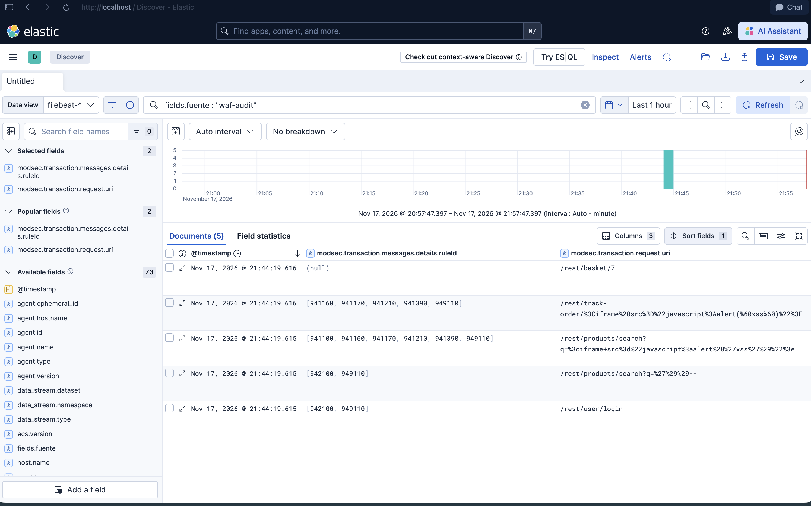
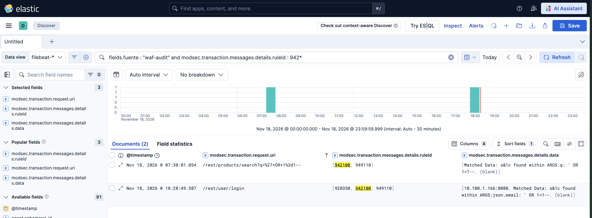
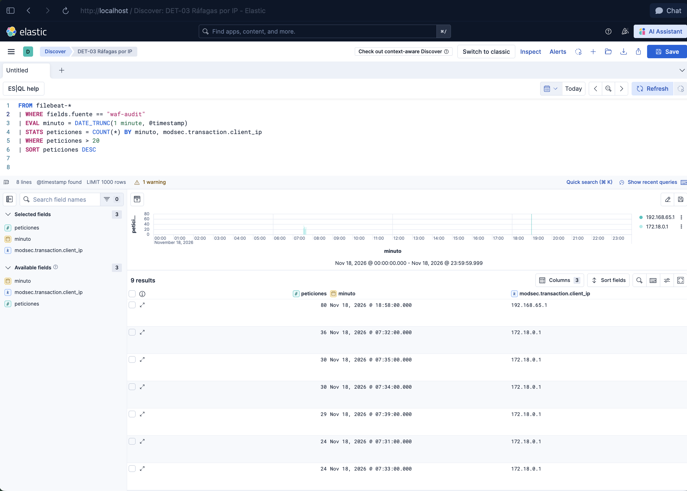
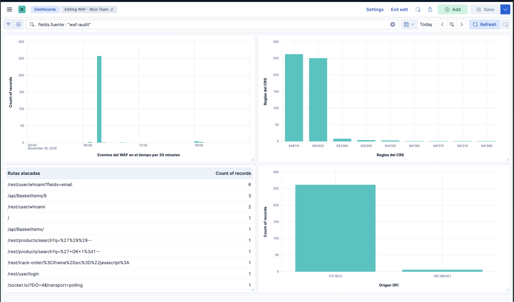
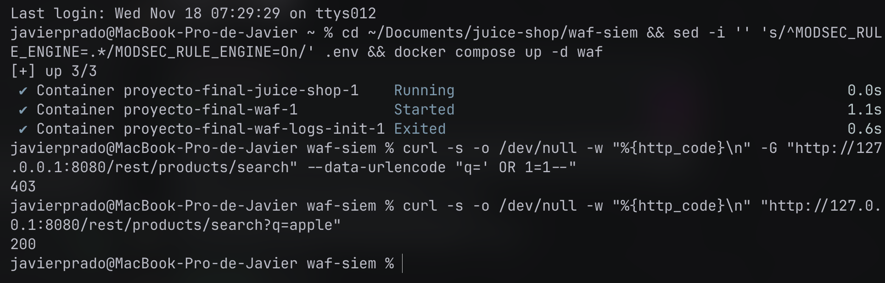

# Hito 3 · Detección y respuesta

> Reglas DET-01/DET-02, dashboard y modo `On`: **Javier Prado** · Regla DET-03, exclusiones y este documento: **Bryan España** · Pasadas de ataque y registro: **Luis Pedro Montenegro**.

**Objetivo del hito:** que el Blue Team **detecte** en Kibana los ataques que el Red Team confirmó en el H2 y luego los **bloquee** con el WAF en modo `On`, sin romper el uso normal de la tienda.

**Entorno:** ModSecurity v3 + OWASP CRS (`owasp/modsecurity-crs:nginx`, paranoia 1) delante de Juice Shop 20.4.0-SNAPSHOT (imagen fijada por digest) → Filebeat 9.3.3 → Elasticsearch → Kibana. El WAF escribe el log de auditoría en JSON y Filebeat lo envía con `fields.fuente: "waf-audit"`; el log de acceso va con `fields.fuente: "waf-access"`. Data view: `filebeat-*`.




---

## 1. Reglas de detección

Cada regla es una **búsqueda guardada** de Kibana Discover sobre `filebeat-*`. Se busca por el `ruleId` del CRS (campo exacto `modsec.transaction.messages.details.ruleId`), no por texto libre: así la regla no depende de cómo venga escrito el payload, sino de la familia de ataque que el CRS reconoce.

Columnas de las reglas: `ruleId` (qué regla del CRS saltó), `request.uri` (a qué ruta) y `details.data`, que muestra **el payload y el campo donde llegó** (por ejemplo `found within ARGS:json.email`).

### DET-01 · Inyección SQL

| | |
|---|---|
| **Consulta (KQL)** | `fields.fuente : "waf-audit" and modsec.transaction.messages.details.ruleId : 942*` |
| **Qué detecta** | Cualquier regla de la familia **942** del CRS (ataques SQLi) |
| **PoC que detecta** | **PoC-01** SQLi en el login y **PoC-02** SQLi en la búsqueda |
| **Requisito / caso de abuso** | RS-01, RS-10 · CA-01, CA-02 |

| PoC | Petición | Reglas | `details.data` |
|---|---|---|---|
| PoC-01 | `POST /rest/user/login` | 942100, 949110 | `found within ARGS:json.email: ' OR 1=1--` |
| PoC-02 | `GET /rest/products/search?q='))--` | 942100, 949110 | `found within ARGS:q: '))--` |



### DET-02 · Cross-Site Scripting

| | |
|---|---|
| **Consulta (KQL)** | `fields.fuente : "waf-audit" and modsec.transaction.messages.details.ruleId : 941*` |
| **Qué detecta** | Cualquier regla de la familia **941** del CRS (ataques XSS) |
| **PoC que detecta** | **PoC-03b** XSS reflejado en el rastreo de pedidos |
| **Requisito / caso de abuso** | RS-03, RS-10 · CA-03 |

| PoC | Petición | Reglas | `details.data` |
|---|---|---|---|
| PoC-03b | `GET /rest/track-order/<iframe src="javascript:alert(`xss`)">` | 941160, 941170, 941210, 941390, 949110 | `<iframe found within REQUEST_FILENAME` |
| PoC-03 (payload enviado al servidor) | `GET /rest/products/search?q=<iframe src="javascript:alert('xss')">` | 941100, 941160, 941170, 941210, 941390, 949110 | `XSS data found within ARGS:q` |


**Por qué DET-02 usa el PoC-03b y no el PoC-03.** El PoC-03 del H2 es un **DOM XSS** en `/#/search?q=`: el frontend de Juice Shop descarga todos los productos (`search('')`) y filtra en el navegador, así que el payload **nunca viaja al servidor** y el WAF no puede verlo. Lo comprobamos enviando el payload exacto: no apareció ningún evento. Por eso el Red Team confirmó un XSS que sí pasa por el servidor: en `/#/track-result?id=<payload>` el frontend llama a `GET /rest/track-order/<payload>`, el WAF lo inspecciona y DET-02 lo detecta.

> **Matiz importante (defensa en profundidad).** Al revisar el código confirmamos que, bajo Docker, el reto *Reflected XSS* está deshabilitado (`disabledEnv: [Docker, Heroku]` con `safetyMode: auto`). Por eso `routes/trackOrder.ts` aplica `.replace(/[^\w-]+/g, '')` y la respuesta refleja el valor **sin** caracteres HTML (p. ej. `iframesrcjavascriptalertxss`), de modo que **no se ejecuta `alert('xss')`**. Lo que DET-02 aporta no es menos valioso: **el WAF sí ve e identifica el intento** (reglas 941) aunque la app lo neutralice. Es el ejemplo de defensa en profundidad del H3 — app saneando + WAF detectando. El XSS reflejado queda como **riesgo residual documentado** (no se habilita el reto en la instancia compartida).

### DET-03 · Ráfagas o escaneo por IP

| | |
|---|---|
| **Consulta (ES\|QL)** | Ver el bloque de abajo |
| **Qué detecta** | Una IP que genera más de 20 eventos del WAF en un mismo minuto |
| **Umbral y justificación** | Más de 20 eventos por IP y por minuto. Ver la explicación de abajo |
| **PoC que detecta** | Ráfaga del Red Team del 18-nov a las 18:58: 80 eventos en un minuto |
| **Requisito / caso de abuso** | RS-04, RS-10 · CA-05 |

```sql
FROM filebeat-*
| WHERE fields.fuente == "waf-audit"
| EVAL minuto = DATE_TRUNC(1 minute, @timestamp)
| STATS peticiones = COUNT(*) BY minuto, modsec.transaction.client_ip
| WHERE peticiones > 20
| SORT peticiones DESC
```

**Cómo funciona.** A diferencia de DET-01 y DET-02, esta regla no busca un payload sino un comportamiento. Agrupa los eventos del log de auditoría del WAF por minuto y por IP de origen, y muestra solo los grupos que pasan de 20. Se usa ES|QL porque KQL no puede contar ni agrupar.

**Por qué el umbral es 20 por minuto.** El log de auditoría (`waf-audit`) no guarda todo el tráfico: registra las transacciones que disparan alguna regla del CRS o que terminan en error. Una persona que usa la tienda con normalidad casi no genera eventos ahí, porque registro, login, búsqueda y carrito no disparan reglas (sección 3). Un escáner o una herramienta automática, en cambio, prueba muchas rutas y payloads seguidos, y cada intento sospechoso o fallido queda registrado. La ráfaga del Red Team generó 80 eventos en un minuto, cuatro veces el umbral. El valor 20 deja margen para un usuario que comete algunos errores y aun así marca cualquier escaneo automatizado.

**Hallazgo al calibrar el umbral.** En la captura aparecen también siete minutos entre las 07:31 y las 07:39 con 24 a 36 eventos desde `172.18.0.1`. No son un ataque: es el ensayo del modo `On` de Javier usando la tienda como cliente normal, y coinciden con el falso positivo de socket.io (más de 200 bloqueos de la regla 920420 en diez minutos, sección 3). Es decir, antes de la exclusión `10003` un usuario legítimo superaba el umbral solo por el reintento de las notificaciones. Con la exclusión aplicada ese tráfico deja de generar eventos, y DET-03 queda calibrada para marcar solo ráfagas reales. Es un ejemplo de cómo un falso positivo del WAF se propaga a las reglas del SIEM.

**Limitaciones.**
- Un escaneo lento, por debajo de 20 eventos por minuto, no salta. Para eso habría que agregar una ventana más larga, por ejemplo una hora.
- Con Docker Desktop en Mac, las conexiones que llegan desde otra máquina se ven con la IP del gateway de Docker (`192.168.65.1`), no con la IP real del atacante. Por eso la ráfaga del Red Team aparece con esa IP. En el laboratorio basta, pero en producción el WAF tendría que recibir la IP real del cliente, por ejemplo con `X-Forwarded-For` desde un balanceador de confianza.



### Cobertura de los PoC del H2

| PoC | Vulnerabilidad | ¿Lo ve el WAF? | Regla del SIEM | Motivo |
|---|---|---|---|---|
| PoC-01 | SQLi en el login | ✅ 942100 | **DET-01** | |
| PoC-02 | SQLi en la búsqueda | ✅ 942100 | **DET-01** | |
| PoC-03 | DOM XSS en `/#/search` | ❌ | — | El payload se procesa en el navegador y no llega al servidor |
| PoC-03b | XSS reflejado en `/rest/track-order` | ✅ 941160, 941170, 941210, 941390 | **DET-02** | |
| PoC-04 | IDOR en `/rest/basket/:id` | ❌ | — | Es una petición válida: el WAF no conoce al dueño del carrito. Es lógica de negocio y se corrige en el código en el H4 (RS-02) |

---

## 2. Dashboard "WAF - Blue Team"

Dashboard de Kibana con el filtro `fields.fuente : "waf-audit"` y cuatro paneles (Lens):

| Panel | Campo | Para qué sirve |
|---|---|---|
| Eventos del WAF en el tiempo | Conteo sobre `@timestamp` | Ver cuándo ocurre un ataque o una ráfaga |
| Reglas del CRS | Top 10 de `modsec.transaction.messages.details.ruleId` | Qué familias de ataque están saltando (942 SQLi, 941 XSS…) |
| Rutas atacadas | Tabla con el top de `modsec.transaction.request.uri` | Qué endpoints de la API reciben los ataques |
| Origen (IP) | Top de `modsec.transaction.client_ip` | Quién ataca. En la pasada del Red Team aparece la IP de su laptop |



---

## 3. WAF en modo `On`

Se cambia `MODSEC_RULE_ENGINE=On` en `waf-siem/.env` y se recrea el contenedor (`docker compose up -d waf`; un `restart` no vuelve a leer el `.env`). Con el motor en `On`, cuando el puntaje de anomalía de una petición supera el umbral (regla **949110**), el WAF responde **403** y la petición no llega a Juice Shop.

**Ensayo (2026-11-18, 07:30 hora de Guatemala), antes de las exclusiones:**

| Petición | Resultado |
|---|---|
| `GET /rest/products/search?q=' OR 1=1--` (SQLi) | **403** bloqueado (942100) |
| `GET /rest/products/search?q=apple` (búsqueda normal) | **200** |



**Pasada de bloqueo del Red Team (2026-11-19).** Luis Pedro reenvió sus PoC desde su equipo contra el WAF de Javier a través de una red privada Tailscale, con el motor en `On`. Los tres terminaron en **403**:

| PoC | Petición | Hora (GT, UTC−6) | Reglas | Resultado |
|---|---|---|---|---|
| PoC-01 (SQLi login) | `POST /rest/user/login` con `' OR 1=1--` | 11:51:08 | 942100, 949110 | **403** bloqueado |
| PoC-02 (SQLi búsqueda) | `GET /rest/products/search?q='))--` | 11:53:12 | 942100, 949110 | **403** bloqueado |
| PoC-03b (XSS rastreo) | `GET /rest/track-order/<iframe src="javascript:alert(\`xss\`)">` | 11:53:26 | 941160, 941170, 941210, 941390, 949110 | **403** bloqueado |

Evidencia: `img/06-waf-403-bloqueo.png` (Kibana, lado del Blue Team) y las capturas de Postman del Red Team (`img/postman-sqli-login-403.png`, `img/postman-sqli-products-403.png`, `img/postman-xss-403.png`). El origen se registra como `192.168.65.1`, la puerta de enlace de Docker Desktop: por el NAT de Docker en macOS la IP real del atacante no llega al contenedor. Se documenta como limitación del entorno; la correlación con el Red Team se hace por la hora.

### Falsos positivos encontrados en el ensayo

En el mismo ensayo se usó la tienda como un cliente normal (registro, login, carrito, cambio de cantidad y reseña) para ver qué rompía el modo `On`. Aparecieron dos falsos positivos:

| Petición legítima | Regla | `details.data` | Por qué salta | Efecto en la tienda |
|---|---|---|---|---|
| `GET /rest/user/whoami` | **932260** (RCE, comandos Unix) | `/rest/user/whoami found within REQUEST_FILENAME` | La ruta contiene la palabra `whoami`, que también es un comando de Unix | La app no sabe quién está logueado: el carrito sale como "(anonymous)" y las reseñas como "Anonymous" |
| `POST /socket.io/?EIO=4&transport=polling…` | **920420** (Content-Type no permitido) | `text/plain` | El polling de socket.io envía `text/plain`, que no está en la lista de tipos permitidos del CRS | Se cortan las notificaciones en tiempo real; el navegador reintenta sin parar (más de 200 bloqueos en 10 minutos) y la tienda se vuelve lenta |

Registro, login, búsqueda y carrito no dispararon reglas. Los `400`/`500` de `/api/BasketItems` que aparecen en el log son respuestas de la propia aplicación (sin reglas del CRS), no bloqueos del WAF.

Consulta para verlos en Discover: `fields.fuente : "waf-audit" and modsec.transaction.response.http_code : 403`.


---

## 4. Exclusiones mínimas

Archivo: [`waf-siem/waf/REQUEST-900-EXCLUSION-RULES-BEFORE-CRS.conf`](../../waf-siem/waf/REQUEST-900-EXCLUSION-RULES-BEFORE-CRS.conf). La exclusión `10001` (Host `127.0.0.1`, regla 920350) viene del H0. Ninguna exclusión toca la 949110 ni apaga una familia completa del CRS.

| ID | Regla | Ruta y alcance | Tipo | Por qué es un falso positivo | Riesgo que se acepta |
|---|---|---|---|---|---|
| 10002 | 932260 (RCE, comandos Unix) | `/rest/user/whoami`, ruta exacta. Solo se quita el objetivo `REQUEST_FILENAME` | 1 | Es la ruta de la API que devuelve el usuario logueado. La regla ve la palabra `whoami` en la ruta y la confunde con el comando de Unix | En esa ruta la 932260 no revisa el nombre de la ruta. Los parámetros y headers siguen inspeccionados por todas las reglas, incluida la 932260 |
| 10003 | 920420 (Content-Type no permitido) | `/socket.io/`, ruta exacta, solo `POST` y solo con `Content-Type` que empieza con `text/plain` | 2 acotada | El polling de socket.io envía sus mensajes como `text/plain`, que no está en la lista de tipos permitidos del CRS | **Riesgo residual.** El CRS no tiene procesador de cuerpo para `text/plain`, así que el contenido de esas peticiones no llega a las reglas 942 ni 941 |

**Por qué la 10003 no quita solo un objetivo.** La 920420 revisa únicamente el header `Content-Type`, así que quitarle ese objetivo equivale a quitar la regla completa. Para que la exclusión sea mínima se limitó con una cadena de tres condiciones: ruta exacta, método `POST` y `text/plain`. Si cambia cualquiera de las tres, la 920420 vuelve a aplicar.

**Análisis del riesgo de la 10003.** Lo comprobamos enviando `POST /socket.io/` con `Content-Type: text/plain` y el payload `' OR 1=1--` en el body, con el WAF en `DetectionOnly`: en Kibana solo saltaron 920420 y 949110, ninguna 942. Antes de la exclusión esa petición se bloqueaba igual por la 920420; después pasa sin que el CRS mire su contenido. Aceptamos el riesgo porque está limitado a esa ruta exacta y porque revisamos el código del servidor de socket.io (`lib/startup/registerWebsocketEvents.ts`): los mensajes solo se comparan contra listas en memoria, con `includes` y una expresión regular, y nunca se usan en una consulta a la base de datos. Queda en el riesgo residual del informe final.

### Verificación en modo `On`

Después de editar el archivo: `docker compose restart waf` con `MODSEC_RULE_ENGINE=On`. Para cada exclusión se comprueba que la acción legítima ya no se bloquea y que un ataque en la misma ruta sigue dando 403. Verificación ejecutada el **2026-11-19** con el motor en `On`:

| # | Prueba | Resultado esperado | Resultado obtenido |
|---|---|---|---|
| 1 | Usar la tienda logueado: el carrito muestra el correo y no aparecen 403 en `/rest/user/whoami` ni en `/socket.io/` | Sin 403 | **200** en `/rest/user/whoami`, sin 403 ✅ |
| 2 | `GET /rest/user/whoami?x=;cat /etc/passwd` | 403 | **403** ✅ |
| 3 | `POST /socket.io/` con `text/plain` y `' OR 1=1--` en el body | Sin 403 del WAF; en Kibana sin 920420 ni 949110 | **400** de la app (no 403 del WAF); confirmado en Kibana: **0 eventos** para esa petición (ni 920420 ni 949110) ✅ |
| 4 | `POST /socket.io/` con `application/json` y el mismo payload | 403 | **403** ✅ |
| 5 | `GET /socket.io/?q=' OR 1=1--` | 403 | **403** ✅ |
| 6 | `POST /rest/user/login` con `text/plain` y el mismo payload, para confirmar que la exclusión no se amplió a otras rutas | 403 | **403** ✅ |

```bash
curl -s -o /dev/null -w "%{http_code}\n" -G "http://127.0.0.1:8080/rest/user/whoami" --data-urlencode "x=;cat /etc/passwd"
curl -s -o /dev/null -w "%{http_code}\n" -X POST "http://127.0.0.1:8080/socket.io/" -H "Content-Type: text/plain" --data "' OR 1=1--"
curl -s -o /dev/null -w "%{http_code}\n" -X POST "http://127.0.0.1:8080/socket.io/" -H "Content-Type: application/json" --data "{\"q\":\"' OR 1=1--\"}"
curl -s -o /dev/null -w "%{http_code}\n" -G "http://127.0.0.1:8080/socket.io/" --data-urlencode "q=' OR 1=1--"
curl -s -o /dev/null -w "%{http_code}\n" -X POST "http://127.0.0.1:8080/rest/user/login" -H "Content-Type: text/plain" --data "' OR 1=1--"
```

La prueba 3 puede devolver un 400 de la propia aplicación, porque socket.io no reconoce ese body. Lo que importa es que no sea un 403 del WAF.

**Evidencia en el WAF de Bryan (2026-11-19, 13:23 a 13:38 hora de Guatemala, modo `On`).** Se usó la tienda como el usuario semilla `jim@juice-sh.op`: login, carrito y compra completa. Las notificaciones de retos resueltos llegaron por socket.io, lo que confirma la exclusión `10003`, y la compra salió a nombre de Jim, lo que confirma que `/rest/user/whoami` responde y que la `10002` funciona. En el mismo intervalo, el único 403 en Kibana fue el ataque `GET /rest/user/whoami?x=;cat /etc/passwd` a las 13:35:43, bloqueado por las reglas 930120 (acceso a archivos del sistema) y 932160 (comando de shell Unix), que suman puntaje en la 949110. Es decir, la `10002` solo quitó la ruta de la 932260 y el resto del CRS sigue protegiendo ese endpoint.


---

## 5. Export de Kibana

[`waf-siem/kibana-export.ndjson`](../../waf-siem/kibana-export.ndjson): reglas DET-01, DET-02, DET-03 y el dashboard "WAF - Blue Team", exportados desde Stack Management → Saved Objects con *Include related objects*. Se importan en otro Kibana desde la misma pantalla (**Import**).

*(Captura `08-saved-objects-export.png` pendiente: la pantalla de Saved Objects con los objetos exportados.)*

---

## 6. Demo Purple Team *(pendiente)*

*(PoC elegido, hora, evidencia de la detección en la regla y del 403 en modo `On`.)*

## 7. Registro de ataques del Red Team *(Luis Pedro)*

| Fecha y hora | Hallazgo | Herramienta | Destino (ruta) | Payload | Resultado (HTTP) | ¿WAF? |
|---|---|---|---|---|---|---|
| | | | | | | |

---

## Uso de IA

| Qué | Herramienta | Qué se le pidió | Qué produjo | Revisión del grupo |
|---|---|---|---|---|
| Reglas DET-01/DET-02 y dashboard | **Claude Code** (Anthropic) | Guiar la creación de las búsquedas guardadas y los paneles en Kibana | Pasos en Kibana y consultas KQL por familia del CRS | Javier creó las reglas y el dashboard en su Kibana y comprobó los resultados con los payloads de los PoC |
| Análisis del ensayo en modo `On` | **Claude Code** (Anthropic) | Revisar los eventos del WAF de la prueba con la tienda | Identificó los dos falsos positivos (932260 en `whoami`, 920420 en `socket.io`) consultando Elasticsearch | Javier los confirmó en Discover (captura `07a`) |
| Redacción de las secciones 1–3 de este documento | **Claude Code** (Anthropic) | Redactar a partir del trabajo hecho en Kibana | Texto y tablas de las secciones 1–3 | Javier y Bryan revisaron el contenido |
| DET-03 y exclusiones 10002/10003 | **Claude** (Anthropic) | Revisar la propuesta de exclusiones, el criterio de prueba y documentar DET-03 | Ajustes a la exclusión 10003 y a las pruebas en modo `On`, revisión del código de socket.io y redacción de DET-03 y la sección 4 | Bryan y Javier discutieron y acordaron la versión final de la 10003; Bryan revisó el texto |
