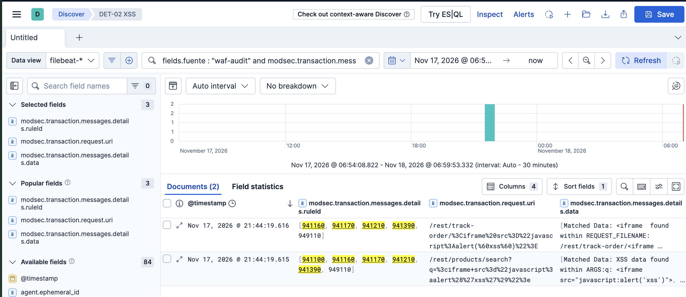
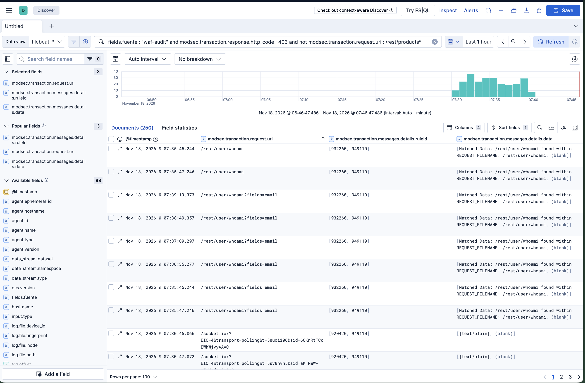
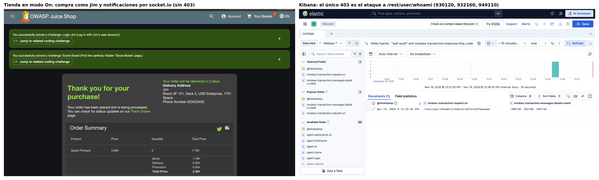
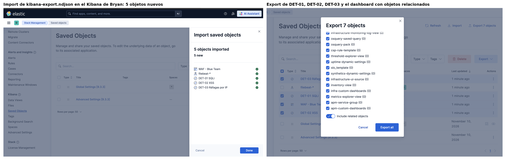

# Hito 3 · Detección y respuesta

> Reglas DET-01/DET-02, dashboard y modo `On`: **Javier Prado** · Regla DET-03, exclusiones y este documento: **Bryan España** · Pasadas de ataque y registro: **Luis Pedro Montenegro**.

**Objetivo del hito:** que el Blue Team **detecte** en Kibana los ataques que el Red Team confirmó en el H2 y luego los **bloquee** con el WAF en modo `On`, sin romper el uso normal de la tienda.

**Entorno:** ModSecurity v3 + OWASP CRS (`owasp/modsecurity-crs:nginx`, paranoia 1) delante de Juice Shop 20.4.0-SNAPSHOT (imagen fijada por digest) → Filebeat 9.3.3 → Elasticsearch → Kibana. El WAF escribe el log de auditoría en JSON y Filebeat lo envía con `fields.fuente: "waf-audit"`; el log de acceso va con `fields.fuente: "waf-access"`. Data view: `filebeat-*`.

> **Estado de las capturas:** la `02`, `03`, `05` y `06` se tomaron con los payloads exactos de los PoC de Luis Pedro, enviados desde la Mac de Javier. Se reemplazan por las de la pasada de detección del Red Team (por el WAF de Javier en el hotspot), para que se vean su hora y su IP. *(Quitar esta nota cuando estén las definitivas.)*

---

## 1. Reglas de detección

Cada regla es una **búsqueda guardada** de Kibana Discover sobre `filebeat-*`. Se busca por el `ruleId` del CRS (campo exacto `modsec.transaction.messages.details.ruleId`), no por texto libre: así la regla no depende de cómo venga escrito el payload, sino de la familia de ataque que el CRS reconoce.

Columnas de las reglas: `ruleId` (qué regla del CRS saltó), `request.uri` (a qué ruta) y `details.data`, que muestra **el payload y el campo donde llegó** (por ejemplo `found within ARGS:json.email`).

### DET-01 · Inyección SQL

| | |
|---|---|
| **Consulta (KQL)** | `fields.fuente : "waf-audit" and modsec.transaction.messages.details.ruleId : 942*` |
| **Qué detecta** | Cualquier regla de la familia **942** del CRS (ataques SQLi) |
| **PoC que detecta** | **PoC-01** SQLi en el login y **PoC-02** SQLi en la búsqueda |
| **Requisito / caso de abuso** | RS-01, RS-10 · CA-01, CA-02 |

| PoC | Petición | Reglas | `details.data` |
|---|---|---|---|
| PoC-01 | `POST /rest/user/login` | 942100, 949110 | `found within ARGS:json.email: ' OR 1=1--` |
| PoC-02 | `GET /rest/products/search?q='))--` | 942100, 949110 | `found within ARGS:q: '))--` |

### DET-02 · Cross-Site Scripting

| | |
|---|---|
| **Consulta (KQL)** | `fields.fuente : "waf-audit" and modsec.transaction.messages.details.ruleId : 941*` |
| **Qué detecta** | Cualquier regla de la familia **941** del CRS (ataques XSS) |
| **PoC que detecta** | **PoC-03b** XSS reflejado en el rastreo de pedidos |
| **Requisito / caso de abuso** | RS-03, RS-10 · CA-03 |

| PoC | Petición | Reglas | `details.data` |
|---|---|---|---|
| PoC-03b | `GET /rest/track-order/<iframe src="javascript:alert(`xss`)">` | 941160, 941170, 941210, 941390, 949110 | `<iframe found within REQUEST_FILENAME` |
| PoC-03 (payload enviado al servidor) | `GET /rest/products/search?q=<iframe src="javascript:alert('xss')">` | 941100, 941160, 941170, 941210, 941390, 949110 | `XSS data found within ARGS:q` |

**Por qué DET-02 usa el PoC-03b y no el PoC-03.** El PoC-03 del H2 es un **DOM XSS** en `/#/search?q=`: el frontend de Juice Shop descarga todos los productos (`search('')`) y filtra en el navegador, así que el payload **nunca viaja al servidor** y el WAF no puede verlo. Lo comprobamos enviando el payload exacto: no apareció ningún evento. Por eso el Red Team confirmó un XSS que sí pasa por el servidor: en `/#/track-result?id=<payload>` el frontend llama a `GET /rest/track-order/<payload>`, el WAF lo inspecciona y DET-02 lo detecta.

### DET-03 · Ráfagas o escaneo por IP *(Bryan)*

| | |
|---|---|
| **Consulta (ES\|QL)** | *(pegar la consulta final con el umbral ajustado)* |
| **Qué detecta** | |
| **Umbral y justificación** | *(eventos por minuto de un usuario normal vs. un escaneo)* |
| **PoC que detecta** | |
| **Requisito / caso de abuso** | RS-04, RS-10 · CA-05 |

### Cobertura de los PoC del H2

| PoC | Vulnerabilidad | ¿Lo ve el WAF? | Regla del SIEM | Motivo |
|---|---|---|---|---|
| PoC-01 | SQLi en el login | ✅ 942100 | **DET-01** | |
| PoC-02 | SQLi en la búsqueda | ✅ 942100 | **DET-01** | |
| PoC-03 | DOM XSS en `/#/search` | ❌ | — | El payload se procesa en el navegador y no llega al servidor |
| PoC-03b | XSS reflejado en `/rest/track-order` | ✅ 941160, 941170, 941210, 941390 | **DET-02** | |
| PoC-04 | IDOR en `/rest/basket/:id` | ❌ | — | Es una petición válida: el WAF no conoce al dueño del carrito. Es lógica de negocio y se corrige en el código en el H4 (RS-02) |

---

## 2. Dashboard "WAF - Blue Team"

Dashboard de Kibana con el filtro `fields.fuente : "waf-audit"` y cuatro paneles (Lens):

| Panel | Campo | Para qué sirve |
|---|---|---|
| Eventos del WAF en el tiempo | Conteo sobre `@timestamp` | Ver cuándo ocurre un ataque o una ráfaga |
| Reglas del CRS | Top 10 de `modsec.transaction.messages.details.ruleId` | Qué familias de ataque están saltando (942 SQLi, 941 XSS…) |
| Rutas atacadas | Tabla con el top de `modsec.transaction.request.uri` | Qué endpoints de la API reciben los ataques |
| Origen (IP) | Top de `modsec.transaction.client_ip` | Quién ataca. En la pasada del Red Team aparece la IP de su laptop |

---

## 3. WAF en modo `On`

Se cambia `MODSEC_RULE_ENGINE=On` en `waf-siem/.env` y se recrea el contenedor (`docker compose up -d waf`; un `restart` no vuelve a leer el `.env`). Con el motor en `On`, cuando el puntaje de anomalía de una petición supera el umbral (regla **949110**), el WAF responde **403** y la petición no llega a Juice Shop.

**Ensayo (2026-11-18, 07:30 hora de Guatemala), antes de las exclusiones:**

| Petición | Resultado |
|---|---|
| `GET /rest/products/search?q=' OR 1=1--` (SQLi) | **403** bloqueado (942100) |
| `GET /rest/products/search?q=apple` (búsqueda normal) | **200** |

*(Agregar aquí la pasada de bloqueo del Red Team: cada PoC con su respuesta 403.)*

### Falsos positivos encontrados en el ensayo

En el mismo ensayo se usó la tienda como un cliente normal (registro, login, carrito, cambio de cantidad y reseña) para ver qué rompía el modo `On`. Aparecieron dos falsos positivos:

| Petición legítima | Regla | `details.data` | Por qué salta | Efecto en la tienda |
|---|---|---|---|---|
| `GET /rest/user/whoami` | **932260** (RCE, comandos Unix) | `/rest/user/whoami found within REQUEST_FILENAME` | La ruta contiene la palabra `whoami`, que también es un comando de Unix | La app no sabe quién está logueado: el carrito sale como "(anonymous)" y las reseñas como "Anonymous" |
| `POST /socket.io/?EIO=4&transport=polling…` | **920420** (Content-Type no permitido) | `text/plain` | El polling de socket.io envía `text/plain`, que no está en la lista de tipos permitidos del CRS | Se cortan las notificaciones en tiempo real; el navegador reintenta sin parar (más de 200 bloqueos en 10 minutos) y la tienda se vuelve lenta |

Registro, login, búsqueda y carrito no dispararon reglas. Los `400`/`500` de `/api/BasketItems` que aparecen en el log son respuestas de la propia aplicación (sin reglas del CRS), no bloqueos del WAF.

Consulta para verlos en Discover: `fields.fuente : "waf-audit" and modsec.transaction.response.http_code : 403`.

---

## 4. Exclusiones mínimas *(Bryan)*

Archivo: [`waf-siem/waf/REQUEST-900-EXCLUSION-RULES-BEFORE-CRS.conf`](../../waf-siem/waf/REQUEST-900-EXCLUSION-RULES-BEFORE-CRS.conf). La exclusión `10001` (Host `127.0.0.1`, regla 920350) viene del H0.

| ID | Regla | Ruta · parámetro | Tipo | Por qué es legítimo | Riesgo que se acepta |
|---|---|---|---|---|---|
| 10002 | 932260 | `/rest/user/whoami` · `REQUEST_FILENAME` | | | |
| 10003 | 920420 | `/socket.io/` | | | |

*(Verificación: la acción legítima ya no da 403 y el mismo ataque en esa ruta sigue dando 403.)*

---

## 5. Export de Kibana

[`waf-siem/kibana-export.ndjson`](../../waf-siem/kibana-export.ndjson): reglas DET-01, DET-02, DET-03 y el dashboard "WAF - Blue Team", exportados desde Stack Management → Saved Objects con *Include related objects*. Se importan en otro Kibana desde la misma pantalla (**Import**).

---

## 6. Demo Purple Team *(pendiente)*

*(PoC elegido, hora, evidencia de la detección en la regla y del 403 en modo `On`.)*

## 7. Registro de ataques del Red Team *(Luis Pedro)*

| Fecha y hora | Hallazgo | Herramienta | Destino (ruta) | Payload | Resultado (HTTP) | ¿WAF? |
|---|---|---|---|---|---|---|
| | | | | | | |

---

## Uso de IA

| Qué | Herramienta | Qué se le pidió | Qué produjo | Revisión del grupo |
|---|---|---|---|---|
| Reglas DET-01/DET-02 y dashboard | **Claude Code** (Anthropic) | Guiar la creación de las búsquedas guardadas y los paneles en Kibana | Pasos en Kibana y consultas KQL por familia del CRS | Javier creó las reglas y el dashboard en su Kibana y comprobó los resultados con los payloads de los PoC |
| Análisis del ensayo en modo `On` | **Claude Code** (Anthropic) | Revisar los eventos del WAF de la prueba con la tienda | Identificó los dos falsos positivos (932260 en `whoami`, 920420 en `socket.io`) consultando Elasticsearch | Javier los confirmó en Discover (captura `07a`) |
| Redacción de las secciones 1–3 de este documento | **Claude Code** (Anthropic) | Redactar a partir del trabajo hecho en Kibana | Texto y tablas de las secciones 1–3 | Javier y Bryan revisaron el contenido |
